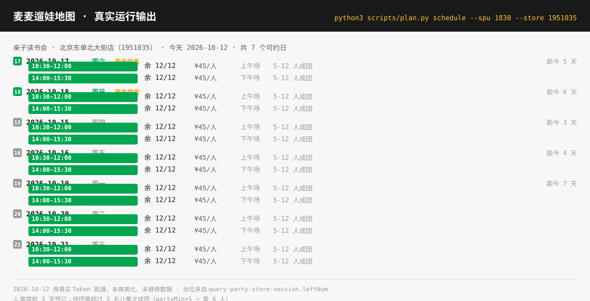

# 🍔 麦麦遛娃地图 · McKids Calendar

**周末带娃去麦当劳，最怕的不是没活动，是不知道去哪家、约哪天、人怎么凑齐。**

**一句话问出去，回来一张能直接发小红书的拼团召集令。**

> 官方规则写明：拼团需**超过 N 名儿童**才可举办，未能成团则**自动取消并自动退款**。  
> 本项目把周末遛娃从「刷 App 找活动」推进到「**去哪家、约哪天、怎么把人凑齐**」：  
> 地图上聚合附近可办门店，按周末与时段排档期，一键生成拼团召集令发出去，  
> 并给出提前 3 天的预订倒计时。

**别人告诉你哪里有活动；我们帮你把场锁上、把人喊来。**

> ⭐ **觉得有用的话，点个 Star 支持一下** —— 本作品正在参加**麦当劳程序员创意开发大赛**，排名只看 GitHub Star 数，一个 Star 就是一张实打实的票。
>
> 👉 https://github.com/Candace666/mcd-kids-calendar

| 纯 Python 标准库 |   麦当劳官方 MCP  |     全链路真实跑通    |     零第三方依赖    |
| :----------: | :----------: | :------------: | :-----------: |
|   3.9+ 即可运行  | `mcp.mcd.cn` | 真实门店 / 场次 / 余位 | 无 pip install |



> 上图为 2026-10-12 用真实 Token 跑通的原始输出，未做美化、未替换数据。

---

## 🎬 先看效果：在线演示（免安装、免 Token）

> **[🍔 打开在线演示页](https://Candace666.github.io/mcd-kids-calendar/)** —— 浏览器打开即**四屏横排**一次看完完整流程：  
> ① 对话提取线索 → ② 地图选门店 → ③ 活动选档 → ④ 召集令 / 下单。  
> 页面为 2026-10-12 真实 Token 跑通的快照（门店经纬度、活动封面、可约日期、剩余名额均来自接口），  
> **不是实时查询**，已明确标注。

演示页地址形如：`https://Candace666.github.io/mcd-kids-calendar/`  
（GitHub Pages 需在仓库 Settings → Pages 中开启，Source 选 `main` 分支 `/docs` 目录）

---

## 🚀 三步开吃

### 第 1 步 · 把这段话整段发给 WorkBuddy（不用碰命令行）

```text
帮我安装这个技能：https://github.com/Candace666/mcd-kids-calendar
把仓库内容放到用户级技能目录 ~/.workbuddy/skills/mcd-kids-calendar/
（SKILL.md 与 src/ scripts/ 需同级保留），确认 SKILL.md 存在，装完提醒我重开一轮会话
```

> **熟手可用命令行**（效果一样，重复执行即更新）：
>
> ```bash
> git clone https://github.com/Candace666/mcd-kids-calendar.git ~/.workbuddy/skills/mcd-kids-calendar
> ```
>
> 卸载：`rm -rf ~/.workbuddy/skills/mcd-kids-calendar`

### 第 2 步 · 对它说一句话

> **「这周六下午带孩子去东单，想找个训练营类的活动」**

它会自己提取日期、地点、活动类型三类线索，在地图上聚合约得到的门店，  
点开看当天的活动与余位，选定后生成召集令或直接下单。

### 第 3 步 · 贴一次 Token，以后一直免配置

第一次使用时按提示到 <https://open.mcd.cn/mcp> 登录 → 控制台 → 激活 → 复制 Token。

**不要贴在对话里。** 正确做法是写进本机环境变量：

```bash
echo 'export MCD_MCP_TOKEN=你的token' >> ~/.zshrc && source ~/.zshrc
```

Token 只写进你本机的环境变量或 WorkBuddy 配置，**不进仓库、不进日志、不在回复里回显**。  
仓库里的 `mcp-config.example.json` 只含 `${MCD_MCP_TOKEN}` 占位符。

> ⚠️ Token 等同账号凭证：只写在自己的本机环境里，不要发群聊、朋友圈或 GitHub。

---

## 📖 目录

| 章节           | 你会看到                    |
| ------------ | ----------------------- |
| 30 秒看懂       | 它和活动查询类 / 省钱工具类的本质差别    |
| 两个能直接发出去的产出物 | 召集令长图与横版卡片              |
| 目标用户         | 谁会用到它、典型场景是什么           |
| 一、痛点         | 为什么真正难的是「去哪家、哪天去、人怎么凑齐」 |
| 二、本项目解决什么    | 三类线索、地图聚合、两阶段查询、年龄只作参考  |
| 三、快速开始       | Token / 配置 / 运行         |
| 四、使用示例       | 对话式、代码式、真实运行输出          |
| 五、能力清单       | 七大能力入口                  |
| 六、实测发现       | 九个改变了产品设计的接口事实          |
| 七、目录结构       | 仓库怎么组织                  |
| 八、隐私与安全      | Token 与下单的边界            |
| 九、参赛信息       | 参赛材料对照                  |

---

## 30 秒看懂：它和别的亲子 Skill 差在哪

亲子赛道已有两类做法，都很不错，但都**停在下单之前**：

| 做法            | 它回答的问题              | 停在              |
| ------------- | ------------------- | --------------- |
| **活动查询 / 雷达** | 「附近哪里有能办的门店」        | 展示即结束           |
| **省钱 / 配餐优化** | 「这一单怎么点最省」          | 算完即结束           |
| **本项目**       | **「去哪家、约哪天、人怎么凑齐」** | 一直管到**锁场 + 拉人** |

差异不在功能多少，而在**是否回答了那个真正会让周末泡汤的问题**：

| 维度    | 查询 / 省钱类 | 本项目                     |
| ----- | -------- | ----------------------- |
| 核心问题  | 哪里有、怎么省  | **去哪家、约哪天、怎么凑齐**        |
| 门店呈现  | 列表或雷达图   | **按真实经纬度聚合的地图 + 活动数折叠** |
| 档期判断  | 无        | **周末优先、时段贴合、提前 3 天倒推**  |
| 人数问题  | 无        | **拼团缺口计算，一图说清还差几人**     |
| 传播环节  | 无        | **召集令，复制即可发小红书 / 朋友圈**  |
| 空结果处理 | 返回空      | **如实说明 + 给两个出口**        |

「拼团需超过 5 名儿童才成团」这条规则，只有先发现它，才会意识到真问题是**凑人**而不是**找活动**——这就是本项目的立足点。

## 两个能直接发出去的产出物

工具算数字容易，产出**能传播的内容**难。周末遛娃是麦当劳场景里自带「发出去」动作的品类：

| 产出物         | 形态        | 用途        |
| ----------- | --------- | --------- |
| **拼团召集令**   | 竖版 3:4 长图 | 小红书图文、朋友圈 |
| **召集令（横版）** | 16:9 卡片   | 二次传播、视频素材 |

> 两者均为单文件 HTML，麦当劳红黄配色，可直接分享；卡上**不含任何券码或凭证**  
> （官方明确「体验券经核销即失效，截屏或转发无效」）。  
> 代码中有递归校验，命中凭证字段即抛错——不靠自觉。

---

## 目标用户

3–12 岁孩子的家长，尤其是一线/新一线城市周末有遛娃需求的人群。

典型场景：周六上午想带孩子出门，不知道附近哪家麦当劳今天有什么活动，  
也不知道要约几个人才成团。

---

## 一、痛点：周末遛娃到底难在哪

带娃出门前，家长真正要回答的是三个问题：

1. **附近哪家门店能办？** —— 实测北京 471 家麦当劳，海底小纵队单个活动覆盖 457 家，  
   但东单北大街一家店就能办 18 个活动。不聚合的话，页面上全是重复的门店。
2. **哪天去合适？** —— 带娃出行的第一约束不是距离也不是价格，是**能不能上得了班**。  
   工作日上午 10:30 的场次对上班族是灾难。
3. **人没凑齐怎么办？** —— 拼团需超过 5 名儿童，凑不齐自动退款。

而麦当劳 App 里，这三件事分散在不同页面，没有一个视图能同时回答。

## 二、本项目解决什么

### 三类线索（从对话提取，缺省自动补）

| 线索       | 用户说了什么            | 没说什么时            |
| -------- | ----------------- | ---------------- |
| **日期**   | 「周六」「下个月」「10月18号」 | 查未来全部可约，按日期排序    |
| **地点**   | 「东单」「望京」「朝阳」      | 按所在城市查全部         |
| **活动类型** | 「训练营」「读书会」「派对」    | 全部 5 类，筛选器默认「全部」 |

**缺省值自动补，不追问。**

> 实测：用户找「训练营」而位置在东单时，体验营类在北京市中心几乎没有——  
> 消防体验营最近 19.3km、职业体验营在望京 11.6km、小小牙医 0 家可办。  
> 此时本项目**不返回空结果**，而是如实说明并给出两个出口：放宽半径，或改看附近可办的其他类型。

### 一个地图聚合视图

实测同一家门店最多可办 **18 个活动**，全量是 **7115 个「门店 × 活动」配对**。  
所以门店被做成地图上的**一个点 + 一个活动数角标**，点开才展开该店的活动列表。

门店坐标、距离、营业状态全部来自 `query-party-store` 真实返回，  
并按 `businessStatus` 与 `onlineBusinessStatus` 过滤掉不可用的门店。

### 两阶段查询（性能）

一次全量核验余位是 24 活动 × 数百门店 = 上千次请求，**实测会超时**。因此：

- **阶段一（秒级）**：只查门店聚合，拿到门店与活动归属关系
- **阶段二（按需）**：用户点开某门店时，再查该店的日期与场次

代码中由 `map_service.aggregate_stores()` 的 `verify_top` 参数控制限量核验。

### 年龄只是参考，不是条件

`mall-product-detail.partyAge` 标注建议 4-12 岁，但**实测 3 岁孩子可以报名成功**，  
`party-order-create` 并不校验年龄。

所以本项目**绝不按年龄过滤或拦截活动**，年龄只出现在展示文案里并标注  
「仅供参考，不作限制」。硬过滤会把真实可参加的活动藏起来。

---

## 三、快速开始

### 1. 获取 MCP Token

到 <https://open.mcd.cn/mcp> 用手机号登录 → 右上角控制台 → 点击「激活」→ 同意服务协议 → 复制 Token。

### 2. 配置 MCP（可选）

命令行方式需要配置；在 WorkBuddy 中直接对话则不需要。

```json
{
  "mcpServers": {
    "mcd-mcp": {
      "type": "streamablehttp",
      "url": "https://mcp.mcd.cn",
      "headers": { "Authorization": "Bearer ${MCD_MCP_TOKEN}" }
    }
  }
}
```

### 3. 运行

```bash
export MCD_MCP_TOKEN=<你的 token>

# 活动库（实测 24 个有效活动）
python3 scripts/plan.py activities

# 地图聚合（实测 471 家门店）
python3 scripts/plan.py stores --city 110100

# 只看某几类
python3 scripts/plan.py stores --types 读书会,主题派对

# 查档期（真实可约日期与余位）
python3 scripts/plan.py schedule --spu 1830 --store 1951035

# 生成召集令（人未凑齐）
python3 scripts/plan.py card --spu 1830 --store 1951035 \
    --date 2026-10-18 --people 5 --time 10:30 --open

# 下单校验（不加 --confirm 不执行写操作）
python3 scripts/plan.py order --spu 1830 --store 1951035 \
    --date 2026-10-18 --people 6 --party-type 2
```

零第三方依赖，纯 Python 标准库，Python 3.9+ 可运行。

---

## 四、使用示例

### 对话式（在 WorkBuddy / Claude Code 等客户端中）

```
用户：这周六下午带孩子去东单，想找个训练营类的活动

麦麦遛娃地图：
  📅 日期：本周六（10/18）下午
  📍 范围：东单 / 东城区
  🎪 类型：体验营
  👶 年龄：未提及 → 不作为条件

  ⚠️ 你找的是训练营类。实测该类在北京仅 3 家门店有活动，最近的 19.3km；
     小小牙医在北京 0 家可办。

  📍 东单 3km 内无训练营类活动。已给出两个出口：
     ① 放宽到 20km
     ② 改看东单附近可办的 18 个活动

  要改看哪个？
```

```
用户：那就看看东单附近的

麦麦遛娃地图：
  按距离排序，共 8 家门店（范围 0.9km - 2.6km）

  📍 北京东单北大街餐厅  1.2km  18 个活动
     ├ 麦当劳亲子读书会        ¥45/人  剩余 12/12  10:30-12:00 / 14:00-15:30
     ├ 麦当劳趣读派对2025      ¥45/人  剩余 12/12  10:30-12:00 / 14:00-15:30
     ├ 麦当劳趣读派对          ¥45/人  剩余 12/12  10:30-12:00 / 14:00-15:30
     └ ... 还有 15 个活动

  📍 北京东华门大街(景泰蓝)餐厅  1.2km  8 个活动
  📍 北京磁器口餐厅              1.6km  5 个活动
```

```
用户：亲子读书会 5 个人，10月18号上午

麦麦遛娃地图：
  ✅ 麦当劳亲子读书会
  📍 北京东单北大街餐厅 · 1.2km
  🗓 10月18日（周六）10:30–12:00
  👶 拼团 · 5 人 · ¥45/人

  ⚠️ 拼团需超过 5 名儿童才成团 —— 5 人不够，还差 1 人。

  建议：生成召集令发小红书凑人，凑齐后回来下单。
```

### 代码式

```bash
# 查档期，按周末优先排序
python3 scripts/plan.py schedule --spu 1830 --store 1951035

# 共 7 个可约日（今天 2026-10-12）
# 2026-10-17 周六  [周末] [5 天后]  10:30-12:00 余 12/12 ¥45  [上午]
#                                  14:00-15:30 余 12/12 ¥45  [下午]
# 2026-10-18 周日  [周末] [6 天后]  10:30-12:00 余 12/12 ¥45  [上午]
# 2026-10-15 周四  [工作日] [3 天后] 10:30-12:00 余 12/12 ¥45
# ...

# 生成召集令（5 人，缺口自动计算为 1 人）
python3 scripts/plan.py card --spu 1830 --store 1951035 \
    --date 2026-10-18 --people 5 --time 10:30

# === 分享文案（可直接复制）===
# 2026-10-18周日 10:30-12:00 北京东单北大街餐厅 有麦当劳亲子读书会
# ¥45 一个人，含儿童餐和活动礼品
# 现在还差 1 人成团
# 东单北大街112、114号（1.2km）
# 有娃的一起约～
#
# 卡片已生成：data/card_vertical.html
```

### 真实运行输出（2026-10-12 实测）


> 上图由真实 Token 跑通，未做美化、未替换数据。抓图命令：  
> `python3 scripts/plan.py schedule --spu 1830 --store 1951035`

---

## 五、能力清单

| 能力      | 入口                                                            |
| ------- | ------------------------------------------------------------- |
| 活动库筛选   | `python3 scripts/plan.py activities`                          |
| 地图聚合门店  | `python3 scripts/plan.py stores --city 110100`                |
| 按类型筛选   | `--types 读书会,主题派对,生日派对,体验营,品鉴会`                               |
| 档期查询与排序 | `python3 scripts/plan.py schedule --spu <id> --store <code>`  |
| 召集令生成   | `python3 scripts/plan.py card ... [--vertical\|--horizontal]` |
| 下单前置校验  | `python3 scripts/plan.py order ... --party-type 2`            |
| 踩坑记录    | [docs/PITFALLS.md](docs/PITFALLS.md)                          |

---

## 六、实测发现：为什么这样做

这些都不是文档抄的，是 2026-10-11/12 用真实 Token 跑出来的。其中几条直接改变了产品设计。

| # | 发现                                    | 造成的影响                    |
| - | ------------------------------------- | ------------------------ |
| 1 | 同一家门店能办 18 个活动；全量 7115 个配对            | 门店必须聚合折叠，否则页面全是重复 Marker |
| 2 | 体验营在市中心几乎没有（最近 19.3km）                | 空结果必须给出口，不能静默返回          |
| 3 | 标注 4-12 岁，3 岁也能报名                     | 年龄绝不用于过滤，只作展示            |
| 4 | MCP 不支持拼团邀请（无 inviteCode/shareUrl）    | 卡片必须是「下单之前的召集令」          |
| 5 | 拼团下限是 `partyMin + 1`                  | 5 人不成团，要 6 人             |
| 6 | 官方 README 接口名写错（`query-partystore-*`） | 按文档抄必然调不通                |
| 7 | 服务端 35 个 tool，文档只写 30 个               | 以 `tools/list` 实测为准      |
| 8 | `note` 字段禁止提取数值做业务判断                  | 所有判断基于真实接口返回             |
| 9 | 价格单位方向相反（分 vs 元）                      | 全部换算收敛到适配层               |

完整记录见 [docs/PITFALLS.md](docs/PITFALLS.md)。

---

## 七、目录结构

```
mcd-kids-calendar/
├── SKILL.md                    Agent 行为指令（三条不可违背的原则）
├── README.md                   本文件
├── MCP_INTEGRATION.md          MCP 接入说明 + 8 个实测坑位
├── CONTEST_DECLARATION.md      参赛声明（官方原文，未改动）
├── workbuddy.md                WorkBuddy 开发上下文
├── mcp-config.example.json     配置示例（仅占位符）
├── LICENSE                     MIT
│
├── src/
│   ├── mcd_client.py           MCP 客户端，写操作代码级拦截
│   ├── adapter.py              适配层：单位换算 + 返回体解析隔离
│   ├── activity_engine.py      模块 A：活动库筛选（50 条 → 24 个）
│   ├── map_service.py          模块 B：门店聚合 + 地图数据
│   ├── scheduler.py            模块 C：档期排序引擎
│   ├── card_builder.py         模块 D：召集令生成 + 凭证拦截
│   └── booking.py              模块 E：下单 + 六项前置校验
│
├── scripts/
│   └── plan.py                 命令行入口
│
└── docs/
    ├── index.html              在线演示页（GitHub Pages）
    └── PITFALLS.md             实测踩坑记录
```

```


```

### 为什么要单独抽一个 adapter 层

麦当劳 MCP 有三个实测坑：返回体不是纯 JSON、价格单位方向相反、  
同一份数据有三种载体。如果业务代码直接碰 MCP 原始返回，这些 bug 就会散落各处。

所以 `adapter.py` 承担全部脏数据处理，**业务层永远拿不到原始响应**，


从架构上杜绝 100 倍金额错误。

---

## 八、隐私与安全

### Token

- 仅从环境变量 `MCD_MCP_TOKEN` 读取，不写入任何文件、不进日志
- `mcp-config.example.json` 只含 `${MCD_MCP_TOKEN}` 占位符
- `.gitignore` 排除了 `.env`、`raw_*.txt` 等中间产物
- 内置请求间隔 ≥ 0.125 秒（保守取 480 次/分钟，官方上限 600）

### 写操作

`party-order-create` 是全项目唯一的扣费入口，防护如下：

1. 代码层：`WRITE_TOOLS` 集合拦截，默认禁止调用
2. `user_confirmed=False` 时直接拒绝，防止 Agent 自主下单
3. 六项前置校验：活动可预约 / SKU 完整 / 成团方式已确认 /  
   余位充足 / 距今 ≥ 3 天 / 人数符合成团条件
4. `partyType=-1`（包场拼团皆可）必须由用户明确选择，不做推断
5. 订单摘要完整展示后才执行
6. 失败不自动重试，避免重复扣款

**本项目不提供取消订单能力**——`cancel-order` 会触发真实退款且不可逆，  
引导用户前往麦当劳官方渠道自行操作。

### 召集令不含凭证

官方 note 明确：「体验券经核销即失效，截屏或转发无效」。  
`card_builder._assert_no_credentials()` 递归校验 payload，  
命中 `FORBIDDEN_FIELDS` 即抛 `ValueError`。

### 数据

- 不采集、不存储、不展示用户订单号与个人消费金额
- 门店地理数据使用有资质的国内地图服务；离线演示仅绘制相对位置示意图

---

## 九、参赛信息

本项目为**麦当劳程序员创意开发大赛**参赛作品，非麦当劳官方产品。

### 参赛材料对照

| 文件                        | 状态                                |
| ------------------------- | --------------------------------- |
| `README.md`               | ✅                                 |
| `CONTEST_DECLARATION.md`  | ✅ 官方原文，未改动                        |
| `MCP_INTEGRATION.md`      | ✅                                 |
| `mcp-config.example.json` | ✅ 仅占位符                            |
| `workbuddy.md`            | ✅                                 |
| 源代码                       | ✅ `src/` + `scripts/`，零第三方依赖      |
| 在线演示                      | ✅ `docs/index.html`（GitHub Pages） |

### 合规说明

- 不输出医疗、营养或其他专业建议，不评价用户饮食是否健康
- 不使用「垃圾食品」「不健康」等表述
- 不暗示与麦当劳官方有合作关系，不使用其 Logo
- 餐品信息、价格及供应状态以麦当劳官方渠道的实时结果为准

---

**Contest Declaration** · 参赛声明见 [CONTEST\_DECLARATION.md](./CONTEST_DECLARATION.md)

---

## ⭐ 如果这个项目帮到了你

**点个 Star 就是最大的支持** —— 本作品参加麦当劳程序员创意开发大赛，排名只看 GitHub Star 数。  
顺手点一下，也能让更多带娃的家长看到它。

👉 https://github.com/Candace666/mcd-kids-calendar
